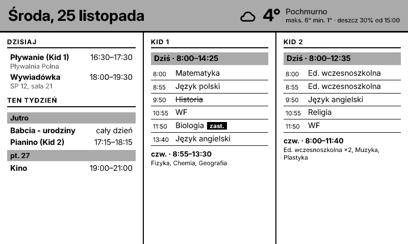
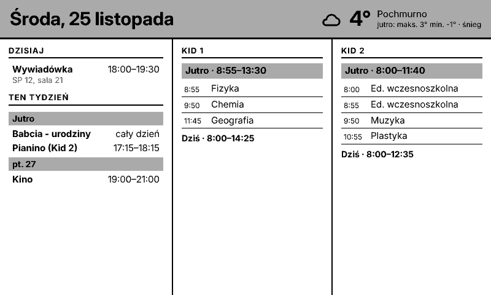

# tablica

A small, self-hosted backend for TRMNL e-ink displays, built for a single household and
configured once.

<p align="center">
  
</p>

<p align="center"><em>The family dashboard as the device shows it (sample data).</em></p>

## Features

### Family dashboard

- **Calendar:** today's events at the top, then the rest of the week grouped by day,
  from a shared iCloud calendar (ICS). Recurring events, exceptions and all-day events
  are handled, locations are shown under the title, and anything that does not fit
  collapses into a "+N więcej" line.
- **School timetables:** one column per kid from Librus Synergia, with each lesson's
  start time, cancelled lessons struck through and substitutions flagged, plus a
  one-line summary of the next school day.
- **Weather:** current temperature and conditions from Open-Meteo, today's high and low,
  and when rain or snow is likely.
- **Follows the day:** in the morning it features today's lessons; after a configurable
  time (`switch_at`) it moves on to the next school day and tomorrow's forecast, while
  still showing when today's lessons end.

<p align="center">
  
</p>

<p align="center"><em>The same dashboard after <code>switch_at</code>: tomorrow comes first.</em></p>

### Under the hood

- **Gentle on Librus:** each kid's timetable is polled more often in the hours before
  school and the evening before a school day, sparsely during lessons and hardly at all
  on days off, with random jitter and the kids staggered apart.
- **Crisp on e-ink:** 2-bit grayscale images (4 shades), with a 1-bit option for each
  device.
- **Polish on screen:** everything the dashboards show is in Polish.
- **No browser needed:** HTML/CSS templates are laid out and rendered in Rust. Pass
  `--templates <dir>` to `tablica serve` to use your own templates; edits are picked up
  without a restart.
- **Survives outages:** when a source is down, the screen keeps the last good data with
  a "stan na …" (as of) note.
- **Battery-friendly:** refreshes every 15 minutes between wake and sleep times, wakes
  just after `switch_at` so the switch shows up on time, and sleeps through the night.
- **Configured, not managed:** one config file, secrets kept in files, and no admin UI
  or database.
- **One container:** a single Rust binary, published as a multi-arch (amd64/arm64)
  Docker image.

### Planned

- **Homelab dashboard:** a device can already be pointed at it, but it shows a
  placeholder for now.

## Running

Use the compose example in `contrib/docker/docker-compose.yaml`:

1. Copy `config.sample.toml` to `./data/config.toml` and edit it. `./data` is mounted at
   `/data` in the container and also holds the cache. It must be writable by uid 1000
   (`sudo chown -R 1000:1000 data`).
2. Put each secret in its own file under `./secrets/`, named as in the config
   (`trmnl_kitchen_key`, `librus_kid1_password` and so on). Compose mounts them at
   `/run/secrets/`.
3. Run `docker compose -f contrib/docker/docker-compose.yaml up -d`. The server listens
   on port 8080, and `/healthz` reports its state.

To capture Librus fixtures from a real account, run
`tablica capture librus --config <config> --secrets-dir <dir> --out <dir>`.

## Contributing

```sh
mise run lint    # clippy and rustfmt
mise run test    # Rust tests
```

`cargo test write_previews` renders the dashboards with sample data into
`target/preview/`; the screenshots in `docs/images/` come from there.

Commits and pull request titles follow [Conventional Commits](https://www.conventionalcommits.org/).
`feat` and `fix` changes open a release PR (version bump and `CHANGELOG.md`); merging it tags the
version, creates a GitHub release and publishes the image to
`ghcr.io/bwilczynski/tablica` as `<version>` and `latest`. The release workflow needs the
`RELEASE_PLZ_TOKEN` repository secret: a fine-grained PAT for this repository with Contents
and Pull requests read/write (see [release-plz.toml](release-plz.toml) for recovering a
release that failed after tagging).

## License

MIT, see [LICENSE](LICENSE). The Librus login flow is ported from
[librus-api](https://github.com/Mati365/librus-api) (MIT), and the Inter font is under
the SIL Open Font License; see [THIRD_PARTY_NOTICES.md](THIRD_PARTY_NOTICES.md).
